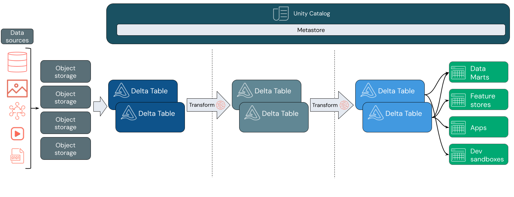
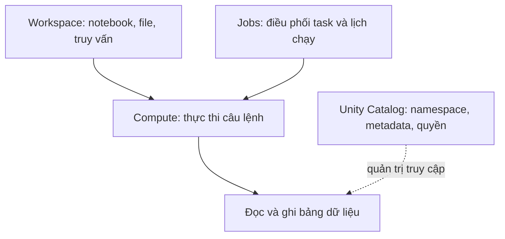
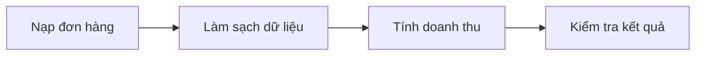
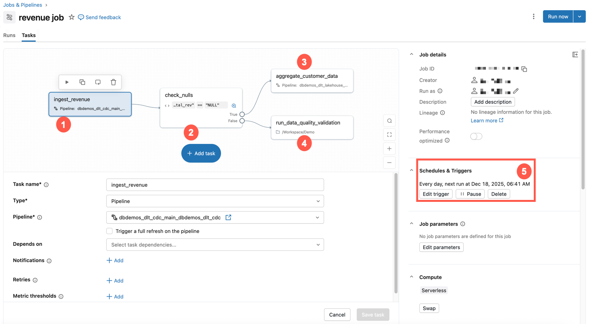
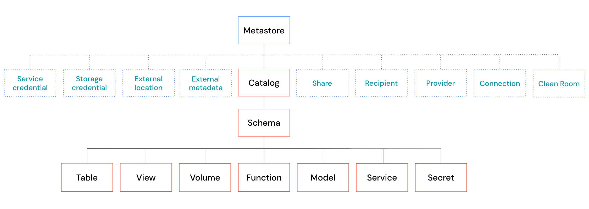
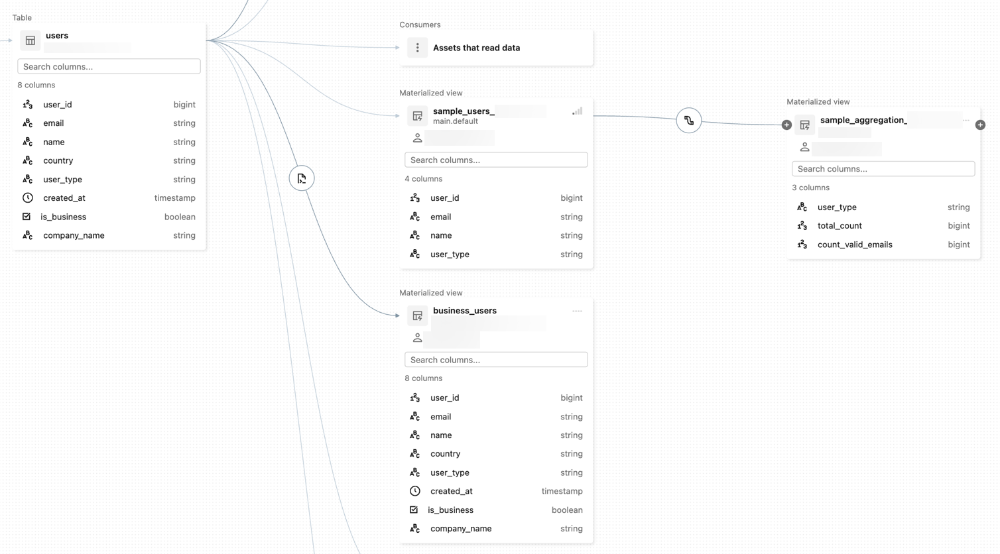

# Databricks & Governance Basics


*Biểu trưng Databricks. Nguồn: [Databricks Documentation](https://docs.databricks.com/aws/en/); sử dụng hình gốc.*

*Từ workspace và jobs đến tổ chức dữ liệu, Unity Catalog và quyền truy cập*

**Đối tượng:** người mới học kỹ thuật dữ liệu, đã biết các câu lệnh SQL cơ bản như `SELECT`, `CREATE TABLE` và `GROUP BY`.

**Mục tiêu:** sau bài học, bạn có thể giải thích vai trò của các thành phần chính trong Databricks; đọc cấu trúc catalog, schema và table; phân tích mô hình cấp quyền theo nhóm và xác định danh tính cần kiểm tra khi truy cập dữ liệu.

**Ví dụ xuyên suốt:** dữ liệu đơn hàng của một cửa hàng trực tuyến. Kỹ sư cần xử lý dữ liệu gốc, còn analyst cần đọc doanh thu tổng hợp.

**Phần thực hành:** [Hands-on: tổ chức dữ liệu và kiểm tra quyền](databricks-governance-hands-on.md).

**Câu hỏi củng cố:** [Quiz ôn tập](databricks-governance-quiz.md).

> **Phạm vi:** bài đọc giới thiệu các thành phần Databricks và mô hình governance của Unity Catalog. Tài liệu chính thức được đối chiếu ngày 27/10/2026; các liên kết tham khảo dùng phiên bản tài liệu Databricks trên AWS.

## 1. Bắt đầu từ một bài toán dữ liệu

Giả sử một cửa hàng trực tuyến nhận hàng nghìn đơn hàng mỗi ngày. Dữ liệu được sử dụng bởi nhiều nhóm: kỹ sư nạp và làm sạch đơn hàng, analyst tính doanh thu, còn người quản lý theo dõi báo cáo kinh doanh.

Ban đầu, mỗi nhóm có thể tải một file về máy và xử lý riêng. Cách làm này dễ bắt đầu, nhưng khi số người và số tác vụ tăng lên, nhóm sẽ phải trả lời những câu hỏi khó hơn: bản dữ liệu nào là bản đang được sử dụng, ai được sửa bảng nguồn, và tại sao hai báo cáo doanh thu lại cho kết quả khác nhau?

Một môi trường làm việc chung giúp các thành viên chia sẻ mã xử lý và khai thác dữ liệu nhất quán hơn. Tuy vậy, việc đưa mọi người vào cùng môi trường chưa giải quyết được toàn bộ vấn đề. Nhóm còn cần quy định trách nhiệm, tổ chức tài sản dữ liệu và kiểm soát những hành động được phép thực hiện.

Đó là hai nội dung chính của bài học này: sử dụng Databricks làm môi trường xử lý dữ liệu và thiết lập các nguyên tắc governance cơ bản ngay trong môi trường đó.

## 2. Các khái niệm nền tảng

### 2.1. Databricks là gì?

**Databricks** là nền tảng phục vụ kỹ thuật dữ liệu, phân tích dữ liệu và AI. Người dùng có thể viết SQL hoặc mã lập trình, chạy các tác vụ xử lý, tổ chức dữ liệu và chia sẻ kết quả trong cùng một hệ sinh thái. Nền tảng tích hợp với tài nguyên lưu trữ và hạ tầng đám mây để thực hiện các công việc này. Xem [tổng quan Databricks][db-intro].

Trong tình huống đơn hàng, một luồng làm việc có thể gồm: đọc dữ liệu đầu vào, loại bỏ đơn không hợp lệ, lưu bảng dữ liệu sạch, tính doanh thu theo ngày và chạy lại các bước đó theo lịch.

Để theo bài học, bạn chưa cần hiểu toàn bộ công nghệ bên trong Databricks. Trước hết, hãy nắm được ba việc: viết công việc cần thực hiện ở đâu, tài nguyên nào thực thi công việc và dữ liệu được tổ chức, quản lý như thế nào.

### 2.2. Data lake, data warehouse và lakehouse

Ba thuật ngữ này giúp đặt Databricks vào bối cảnh của một hệ thống dữ liệu:

| Khái niệm | Cách hiểu ở mức nhập môn | Ví dụ trong bài toán đơn hàng |
| --- | --- | --- |
| **Data lake** | Lưu trữ dữ liệu ở nhiều dạng, gồm cả dữ liệu chưa được chuẩn hóa cho phân tích. | File đơn hàng gốc, log hoặc dữ liệu JSON nhận từ hệ thống bán hàng. |
| **Data warehouse** | Tổ chức dữ liệu phục vụ truy vấn phân tích và báo cáo theo mô hình được quản lý. | Các bảng phục vụ phân tích doanh thu và hiệu quả kinh doanh. |
| **Lakehouse** | Kết hợp khả năng lưu trữ linh hoạt của data lake với các khả năng quản lý bảng và phân tích của data warehouse. | Một nền tảng lưu dữ liệu gốc, xử lý thành bảng và phục vụ phân tích có quản trị. |

Đây là cách phân biệt theo vai trò để bắt đầu học; phạm vi tính năng của một sản phẩm cụ thể có thể rộng hơn các mô tả trong bảng. Databricks sử dụng kiến trúc lakehouse, trong đó Delta Lake và Unity Catalog là những thành phần liên quan trực tiếp đến nội dung bài này. Xem [kiến trúc lakehouse][db-lakehouse].



*Hình 1. Kiến trúc lakehouse trong tài liệu Databricks: dữ liệu từ nhiều nguồn được biến đổi qua các lớp bảng và phục vụ nhiều nhu cầu sử dụng. Unity Catalog quản trị các tài sản liên quan. Nguồn: [What is a data lakehouse?][db-lakehouse].*

Đọc hình từ trái sang phải: dữ liệu đầu vào đi vào vùng lưu trữ, được biến đổi qua các nhóm bảng, rồi phục vụ phân tích hoặc ứng dụng. Phần phía trên nhấn mạnh vai trò quản trị xuyên suốt. Ví dụ xuyên suốt bài học thu nhỏ ý tưởng này thành ba bảng đơn hàng và doanh thu.

### 2.3. Data governance là gì?

**Data governance**, hay quản trị dữ liệu, là cách một tổ chức xác định trách nhiệm, quy tắc và cơ chế sử dụng dữ liệu. Đối với bài toán của chúng ta, governance được cụ thể hóa qua bốn câu hỏi:

1. Dữ liệu nào đang tồn tại và được tổ chức ở đâu?
2. Ai chịu trách nhiệm đối với dữ liệu đó?
3. Ai được đọc, thay đổi hoặc tạo tài sản dữ liệu?
4. Có thể lần theo nguồn gốc và xem xét các hoạt động sử dụng dữ liệu hay không?

Ví dụ, analyst cần bảng doanh thu theo ngày nhưng không có nhiệm vụ sửa đơn hàng gốc. Governance giúp thể hiện yêu cầu nghiệp vụ này thành một cấu trúc dữ liệu và một tập quyền có thể kiểm tra.

Phân quyền là một phần của governance. Việc mô tả dữ liệu, xác định người sở hữu và theo dõi nguồn gốc cũng quan trọng: một bảng có quyền truy cập đúng nhưng không ai hiểu ý nghĩa các cột vẫn khó sử dụng hiệu quả.

### 2.4. Unity Catalog là gì?

**Unity Catalog** là lớp quản trị dữ liệu và tài sản AI của Databricks. Nó cung cấp mô hình tổ chức đối tượng, kiểm soát truy cập và các khả năng liên quan đến khám phá dữ liệu, lineage, audit. Trong bài này, ta đi sâu vào cách đặt tài sản trong namespace và cấp quyền theo nhóm. Xem [giới thiệu Unity Catalog][db-uc].

Nếu Databricks là môi trường để nhóm thực hiện công việc dữ liệu, thì Unity Catalog cung cấp các cơ chế giúp quản lý những tài sản mà công việc đó sử dụng.

## 3. Bức tranh tổng thể: các thành phần liên hệ thế nào?

Hãy theo dõi một thao tác đơn giản: một kỹ sư mở notebook, viết câu `SELECT` và chạy truy vấn. Notebook nằm trong workspace; câu lệnh được thực thi trên compute; bảng được tham chiếu bằng tên trong catalog; quyền truy cập được kiểm tra theo danh tính đang thực thi.

Khi thao tác cần chạy lặp lại, kỹ sư có thể đưa notebook vào một job. Job quyết định tác vụ nào chạy, vào lúc nào và theo quan hệ phụ thuộc nào.



*Hình 2. Quan hệ chức năng giữa các thành phần. Sơ đồ không mô tả vị trí triển khai vật lý hoặc đường truyền mạng.*

| Thành phần | Vai trò chính | Ví dụ |
| --- | --- | --- |
| Workspace | Tổ chức công việc và cộng tác. | Thư mục chứa notebook xử lý đơn hàng. |
| Notebook | Chứa mã, phần diễn giải và kết quả. | Các ô SQL tạo bảng doanh thu. |
| Compute | Cung cấp tài nguyên thực thi. | SQL warehouse hoặc compute dùng cho notebook. |
| Job | Điều phối tác vụ và các lần chạy. | Chạy notebook kiểm tra dữ liệu hằng ngày. |
| Catalog | Nhóm tài sản trong namespace dữ liệu. | Catalog `lab_governance`. |
| Unity Catalog | Quản trị các đối tượng dữ liệu và quyền liên quan. | Quy định analyst được đọc bảng nào. |

Phân biệt những vai trò này giúp giải thích lỗi chính xác hơn. Không tìm thấy notebook là vấn đề khác với không có quyền sử dụng compute; cả hai cũng khác với việc thiếu quyền đọc bảng.

## 4. Workspace, compute và jobs

### 4.1. Workspace: nơi tổ chức công việc

**Workspace** là môi trường để người dùng truy cập notebook, file, truy vấn và các chức năng của Databricks. Nhóm có thể sắp xếp mã nguồn vào thư mục để dễ tìm kiếm và cộng tác. Xem [Workspace UI][db-workspace].

Ví dụ, nhóm tạo một thư mục:

```text
/Shared/order-analytics/
    01_prepare_orders
    02_build_daily_sales
    03_check_results
```

Ba notebook có thể đảm nhiệm ba bước khác nhau. Cách tổ chức này giúp thành viên hiểu công việc, nhưng bản thân đường dẫn thư mục chưa xác định toàn bộ quyền truy cập vào những bảng mà notebook sử dụng.

Một notebook nằm trong `/Shared/order-analytics/` vẫn cần quyền dữ liệu phù hợp để đọc bảng `lab_governance.bronze.orders_raw`.

### 4.2. Compute: nơi câu lệnh được thực thi

**Compute** là tài nguyên tính toán dùng để chạy công việc. Khi viết xong SQL trong notebook, bạn cần một loại compute phù hợp để thực thi câu lệnh. Databricks cung cấp các lựa chọn như serverless compute, classic compute và SQL warehouses. **SQL warehouse** là compute phục vụ truy vấn SQL và phân tích. Xem [tài liệu compute][db-compute].

Ở mức nhập môn, hãy tách hai điều kiện:

- Bạn có được sử dụng tài nguyên thực thi đó không?
- Danh tính thực thi có được thao tác với bảng dữ liệu không?

Một user có thể có quyền đọc bảng nhưng chưa có quyền sử dụng SQL warehouse đang chọn. Ngược lại, user có thể sử dụng warehouse nhưng không được đọc một bảng cụ thể. Cấp thêm quyền bảng không giải quyết được lỗi sử dụng compute.

### 4.3. Job, task, trigger và run

**Job** dùng để điều phối công việc. Một job gồm một hoặc nhiều **task**, mỗi task thực hiện một bước như chạy notebook. Các task có thể có quan hệ phụ thuộc: chỉ bắt đầu bước tính doanh thu sau khi bước làm sạch hoàn thành.

**Trigger** xác định khi nào job được khởi chạy, chẳng hạn theo lịch. **Run** là một lần thực thi cụ thể của job. Databricks gọi sản phẩm điều phối này là **Lakeflow Jobs**. Xem [tài liệu Lakeflow Jobs][db-jobs].



*Hình 3. Ví dụ các task trong một job xử lý đơn hàng.*

Job mô tả công việc cần chạy; run cho biết điều gì xảy ra trong một lần thực thi. Khi kiểm tra lỗi, cần mở đúng run để xem task thất bại, thông báo lỗi và kết quả đã tạo.



*Hình 4. Ảnh giao diện một job minh họa trong tài liệu chính thức, có các task, nhánh điều kiện và lịch chạy. Đây là ảnh tham khảo của Databricks, chưa phải ảnh thực hiện lab trong bài. Nguồn: [Lakeflow Jobs][db-jobs].*

Trong ảnh, các ô ở giữa biểu diễn task và quan hệ phụ thuộc; phần **Schedules & Triggers** ở bên phải cho biết điều kiện chạy. Ví dụ này có nhánh điều kiện nên phức tạp hơn luồng tuyến tính ở Hình 3, nhưng vẫn dùng cùng những khái niệm job, task và trigger.

### 4.4. Người bấm chạy và danh tính thực thi

Jobs có các quyền quản lý riêng, đồng thời có cấu hình **Run as** xác định danh tính thực thi. Với notebook task trong bài học, khi task truy cập bảng, cần xem quyền của danh tính Run as. Người kích hoạt job có thể khác với danh tính này. Xem [quyền và danh tính của Jobs][db-job-permissions].

Giả sử Lan có quyền bấm chạy job. Job được cấu hình chạy bằng danh tính của một kỹ sư có quyền đọc bảng silver. Job có thể đọc silver thành công, nhưng điều đó chưa chứng minh Lan có quyền chạy câu `SELECT` trực tiếp trên bảng ấy.

Trong môi trường vận hành, nhóm thường sử dụng **service principal**, tức danh tính dành cho ứng dụng hoặc tự động hóa, để quản lý quyền thực thi độc lập với tài khoản cá nhân. Bạn có thể quan sát nguyên tắc Run as trong tài liệu hands-on đi kèm.

## 5. Tổ chức dữ liệu: metastore, catalog, schema và table

### 5.1. Đọc cấu trúc từ trên xuống

Unity Catalog tổ chức tài sản theo một hệ thống phân cấp. Với bảng dữ liệu, ta quan tâm đến bốn cấp:

| Cấp | Ý nghĩa | Ví dụ |
| --- | --- | --- |
| **Metastore** | Cấp chứa metadata và các đối tượng Unity Catalog. | Metastore mà workspace đang sử dụng. |
| **Catalog** | Nhóm tài sản theo một phạm vi lớn, như môi trường hoặc đơn vị nghiệp vụ. | `lab_governance`. |
| **Schema** | Chia nhỏ tài sản trong một catalog. | `bronze`, `silver`, `gold`. |
| **Table** | Chứa dữ liệu có cấu trúc theo dòng và cột. | `orders_raw`, `orders_clean`, `daily_sales`. |

Schema còn có thể chứa các đối tượng khác như view, volume và function. Bài này tập trung vào table để làm rõ mô hình trước. Xem [hệ thống đối tượng Unity Catalog][db-objects].



*Hình 5. Hệ thống phân cấp đối tượng Unity Catalog trong tài liệu chính thức. Khi mới học, hãy theo nhánh giữa: Metastore → Catalog → Schema → Table. Các nhánh còn lại minh họa những tài sản khác mà Unity Catalog có thể quản trị. Nguồn: [Unity Catalog securable objects reference][db-objects].*

Áp dụng nhánh này vào dữ liệu đơn hàng, ta có cấu trúc nhỏ hơn:

```text
Metastore
└── lab_governance                   ← catalog
    ├── bronze                       ← schema
    │   └── orders_raw               ← table
    ├── silver
    │   └── orders_clean
    └── gold
        └── daily_sales
```

*Hình 6. Ví dụ cấu trúc dữ liệu đơn hàng theo ba lớp bronze, silver và gold.*

### 5.2. Namespace ba cấp

Tên đầy đủ của một bảng có dạng:

```text
catalog.schema.table
```

Ví dụ:

```sql
SELECT *
FROM lab_governance.gold.daily_sales;
```

Ở đây, `lab_governance` là catalog, `gold` là schema và `daily_sales` là table. Viết tên đầy đủ giúp chỉ rõ đối tượng cần truy vấn, đặc biệt khi các catalog hoặc schema khác nhau có bảng trùng tên.

**Schema** trong ngữ cảnh này là một namespace chứa đối tượng. Từ “schema” cũng có thể chỉ cấu trúc cột và kiểu dữ liệu của một bảng. Khi trao đổi, cần xác định đang nói đến schema chứa bảng hay cấu trúc của bảng.

### 5.3. Chọn cách tổ chức phù hợp

Một nhóm có thể dùng catalog theo môi trường, chẳng hạn `sales_dev` và `sales_prod`; một nhóm khác có thể tổ chức theo đơn vị nghiệp vụ. Bên trong catalog, schema tiếp tục chia dữ liệu theo mục đích sử dụng.

Ví dụ đơn hàng dùng ba schema `bronze`, `silver`, `gold` để làm rõ quá trình biến đổi:

- **Bronze:** giữ dữ liệu đơn hàng ban đầu.
- **Silver:** giữ những đơn hàng đáp ứng quy tắc làm sạch.
- **Gold:** giữ bảng doanh thu tổng hợp để analyst sử dụng.

Đây là một cách tổ chức cho ví dụ, không phải tên bắt buộc của Unity Catalog. Điều cần giải thích được là mỗi cấp dùng để phân chia trách nhiệm, dữ liệu và quyền như thế nào.

### 5.4. Tên bảng và vị trí lưu trữ

Khi làm việc, bạn sẽ gặp ba loại địa chỉ có vai trò khác nhau:

| Địa chỉ | Chỉ đến điều gì? |
| --- | --- |
| `/Shared/order-analytics/01_prepare_orders` | Notebook trong workspace. |
| `lab_governance.bronze.orders_raw` | Đối tượng bảng trong namespace dữ liệu. |
| Một URI của object storage | Vị trí vật lý của các file dữ liệu. |

Catalog và schema mô tả cách tổ chức logic. Vị trí lưu trữ được quản lý bằng cấu hình liên quan; không nên suy ra đường dẫn file vật lý chỉ từ tên notebook hoặc tên schema.

### 5.5. Managed table, external table và Delta Lake

Với **managed table**, Unity Catalog quản lý metadata và vòng đời dữ liệu lưu trữ của bảng. Với **external table**, bảng tham chiếu tới vị trí dữ liệu được quản lý bên ngoài; quản trị qua Unity Catalog vẫn áp dụng khi truy cập bảng qua Databricks. Sự khác biệt này ảnh hưởng đến trách nhiệm quản lý dữ liệu và vòng đời tài sản. Xem [managed tables][db-managed] và [mô hình đối tượng Unity Catalog][db-uc].

Ví dụ trong bài sử dụng managed table để tập trung vào namespace và quyền truy cập.

Các bảng mẫu dùng **Delta Lake**. Delta Lake bổ sung transaction log cho các file dữ liệu Parquet để hỗ trợ giao dịch và quản lý bảng. Trong bài, câu lệnh `USING DELTA` chỉ rõ định dạng bảng; bạn sẽ thao tác qua SQL thay vì chỉnh trực tiếp các file bên dưới. Xem [giới thiệu Delta Lake][db-delta].

## 6. Unity Catalog hỗ trợ governance như thế nào?

### 6.1. Metadata và khám phá dữ liệu

**Metadata** là dữ liệu mô tả một tài sản: tên bảng, cấu trúc cột, mô tả và người sở hữu. Người dùng cần thông tin này để biết bảng nào phù hợp với câu hỏi của mình.

Ví dụ, chỉ nhìn tên `daily_sales` chưa đủ để biết doanh thu có bao gồm đơn hủy hay không. Nhóm nên ghi rõ bảng được xây dựng từ những đơn đã thanh toán và có giá trị dương. Việc mô tả quy tắc nghiệp vụ làm cho tài sản dễ hiểu hơn khi được khám phá qua catalog.

Unity Catalog cung cấp mô hình metadata và khả năng khám phá các đối tượng được quản trị. Xem [tổng quan Unity Catalog][db-uc].

### 6.2. Ownership và trách nhiệm

**Owner** là principal sở hữu đối tượng và có quyền quản lý tương ứng. Ownership liên quan đến khả năng quản trị đối tượng, bao gồm cấp quyền; nó cần được phân biệt với quyền chỉ đọc hoặc sửa dữ liệu. Xem [quản lý quyền và ownership][db-manage-privileges].

Trong ví dụ đơn hàng, quản trị viên tạo và sở hữu các bảng mẫu. User analyst nhận quyền đọc một bảng, nhưng không trở thành owner của bảng ấy. Cách bố trí này giúp việc kiểm thử phản ánh đúng quyền được cấp cho analyst.

### 6.3. Access control

**Access control** xác định principal nào được thực hiện hành động nào trên đối tượng nào. Một quyết định cấp quyền có ba thành phần:

```text
Ai?                  Được làm gì?       Trên tài sản nào?
lab_analysts         SELECT             gold.daily_sales
```

Ngoài grant theo đối tượng, Databricks có các cơ chế như workspace binding, chính sách theo thuộc tính, row filter và column mask. Phạm vi bài này là cấp quyền theo nhóm; những cơ chế chi tiết hơn được dành cho bước học tiếp theo. Xem [các cơ chế kiểm soát truy cập][db-access].

### 6.4. Lineage: kết quả được tạo từ đâu?

**Data lineage** mô tả quan hệ nguồn gốc và biến đổi giữa các tài sản dữ liệu. Khi doanh thu bất thường, ta cần lần ngược từ bảng báo cáo về dữ liệu đầu vào thay vì chỉ xem bảng cuối cùng.

Trong ví dụ, quan hệ dự kiến là:

```text
bronze.orders_raw
        ↓ lọc đơn đã thanh toán và có số tiền dương
silver.orders_clean
        ↓ tổng hợp theo ngày
gold.daily_sales
```

Unity Catalog có khả năng thu thập lineage cho các thao tác được hỗ trợ. Việc xem lineage phụ thuộc quyền truy cập và điều kiện của môi trường. Tài liệu hands-on đi kèm có bài tập khám phá lineage khi workspace đáp ứng điều kiện. Xem [tài liệu lineage][db-lineage].



*Hình 7. Ví dụ giao diện lineage trong tài liệu Databricks. Các nút biểu diễn tài sản và các đường nối biểu diễn quan hệ phụ thuộc. Đây là ảnh tham khảo, không phải lineage của các bảng đơn hàng trong lab. Nguồn: [Lineage in Unity Catalog][db-lineage].*

### 6.5. Audit: hoạt động nào đã xảy ra?

**Audit log** ghi nhận những hoạt động của hệ thống để phục vụ việc xem xét lại: danh tính liên quan, thời điểm, loại hành động và thông tin kết quả tùy sự kiện. Trong Databricks, dữ liệu audit có thể được khai thác qua system table `system.access.audit` khi có quyền và cấu hình phù hợp. Xem [audit log system table][db-audit].

Lineage và audit trả lời hai nhóm câu hỏi khác nhau. Lineage giúp hiểu một bảng được tạo từ đâu; audit hỗ trợ xem xét những hoạt động đã diễn ra. Trong bài học, chỉ cần phân biệt được hai vai trò này, chưa cần xây dựng hệ thống giám sát audit.

## 7. Mô hình phân quyền cơ bản

### 7.1. User, group và service principal

**Principal** là danh tính có thể được cấp quyền. Trong phạm vi bài học:

| Principal | Vai trò |
| --- | --- |
| User | Danh tính của một người dùng. |
| Group | Tập hợp danh tính để quản lý quyền theo nhóm. |
| Service principal | Danh tính dành cho ứng dụng hoặc tác vụ tự động. |

Ví dụ phân quyền sử dụng hai **account group**: `lab_engineers` và `lab_analysts`. Các thành viên nhận quyền phù hợp qua nhóm, giúp quản lý theo trách nhiệm thay vì lặp lại từng grant cho từng người.

Account group có thể được cấp quyền trên dữ liệu Unity Catalog. Workspace-local group là loại nhóm cũ có phạm vi trong workspace và không dùng để cấp quyền trên dữ liệu Unity Catalog. Xem [các loại group trong Databricks][db-groups].

### 7.2. Bắt đầu từ nhu cầu công việc

Trước khi viết `GRANT`, hãy xác định hành động cần thực hiện. Analyst trong ví dụ cần đọc bảng doanh thu theo ngày. Kỹ sư cần đọc và cập nhật dữ liệu đầu vào, đồng thời tạo bảng thử nghiệm trong silver.

Từ yêu cầu này, ta xây dựng ma trận quyền. Việc cấp quyền được xem là hợp lý khi phạm vi đủ cho công việc đã xác định và có thể kiểm tra bằng một tập thao tác cụ thể.

### 7.3. Những quyền cần biết

| Quyền | Phạm vi trong ví dụ | Mục đích |
| --- | --- | --- |
| `USE CATALOG` | Catalog | Sử dụng catalog trong quá trình truy cập đối tượng con. |
| `USE SCHEMA` | Schema | Sử dụng schema trong quá trình truy cập đối tượng con. |
| `SELECT` | Table | Đọc dữ liệu của bảng. |
| `MODIFY` | Table | Thực hiện các thao tác thay đổi dữ liệu như INSERT, UPDATE, DELETE. |
| `CREATE TABLE` | Schema | Tạo bảng trong schema. |

Để đọc một bảng, người dùng cần quyền sử dụng hai cấp cha và quyền đọc đối tượng: `USE CATALOG`, `USE SCHEMA`, `SELECT`. Các quyền có thể được nhận qua những grant trực tiếp hoặc cơ chế kế thừa tương ứng. Để tạo bảng, cần quyền sử dụng các cấp cha cùng `CREATE TABLE` trên schema. Xem [tham chiếu quyền Unity Catalog][db-privileges].

Ví dụ, chỉ cấp `SELECT` trên `lab_governance.gold.daily_sales` có thể vẫn chưa đủ nếu người nhận thiếu quyền sử dụng catalog hoặc schema cha.

### 7.4. Quyền trực tiếp và quyền kế thừa

Một quyền dữ liệu như `SELECT` có thể được cấp trên một bảng hoặc ở cấp chứa nó. Trong privilege model hiện hành, quyền ở catalog và schema có thể được kế thừa xuống các đối tượng con tương ứng, gồm cả những đối tượng được tạo trong tương lai. Xem [mô hình quyền và kế thừa][db-permissions-model].

Vì vậy, hai lựa chọn sau có phạm vi khác nhau:

```sql
-- Quyen doc tren mot bang cu the.
GRANT SELECT ON TABLE lab_governance.gold.daily_sales
TO `lab_analysts`;

-- Quyen doc rong hon, ap dung o pham vi schema.
GRANT SELECT ON SCHEMA lab_governance.gold
TO `lab_analysts`;
```

Trong ví dụ, ta chọn quyền trên bảng cụ thể. Nếu sau này có thêm bảng trong gold, cần chủ động quyết định analyst có được đọc bảng mới hay không.

### 7.5. GRANT, REVOKE và SHOW GRANTS

`GRANT` cấp quyền, `REVOKE` thu hồi một grant, còn `SHOW GRANTS` giúp xem thông tin grant trên đối tượng hoặc của principal. Người thực hiện cần có thẩm quyền quản lý quyền tương ứng, chẳng hạn owner hoặc một danh tính được ủy quyền phù hợp. Xem [quản lý privileges][db-manage-privileges].

Thu hồi một grant không bảo đảm người dùng mất mọi đường truy cập. Nếu user còn nhận cùng quyền từ nhóm khác, cấp cha hoặc ownership, truy vấn có thể vẫn thành công. Khi kiểm tra, hãy tìm nguồn của quyền thay vì chỉ nhìn câu `REVOKE` vừa chạy.

## 8. Những điểm cần nhớ

Databricks cung cấp môi trường để xử lý và khai thác dữ liệu. Workspace giúp tổ chức công việc; compute thực thi; jobs điều phối các bước và các lần chạy. Unity Catalog cung cấp namespace và những cơ chế quản trị tài sản dữ liệu.

Khi bắt đầu thiết kế governance, hãy đi từ nhu cầu công việc đến cấu trúc dữ liệu, sau đó đến ma trận quyền và câu lệnh cấp quyền. Kiểm tra bằng đúng danh tính, trên cả thao tác được phép và bị từ chối, giúp chuyển một cấu hình quyền thành kết quả có thể đánh giá.


**Tiếp tục thực hành:** [Hands-on: tổ chức dữ liệu và kiểm tra quyền](databricks-governance-hands-on.md).

**Tự kiểm tra kiến thức:** [Quiz ôn tập](databricks-governance-quiz.md).

## Tài liệu tham khảo

- [What is Databricks?][db-intro]
- [What is a data lakehouse?][db-lakehouse]
- [Workspace UI][db-workspace]
- [Compute][db-compute]
- [Lakeflow Jobs][db-jobs]
- [Manage identities, permissions, and privileges for Lakeflow Jobs][db-job-permissions]
- [What is Unity Catalog?][db-uc]
- [Unity Catalog securable objects reference][db-objects]
- [Unity Catalog managed tables][db-managed]
- [What is Delta Lake in Databricks?][db-delta]
- [Access control in Unity Catalog][db-access]
- [Unity Catalog privileges reference][db-privileges]
- [Unity Catalog permissions model concepts][db-permissions-model]
- [Manage privileges in Unity Catalog][db-manage-privileges]
- [Groups][db-groups]
- [Lineage in Unity Catalog][db-lineage]
- [Audit log system table reference][db-audit]

[db-intro]: https://docs.databricks.com/aws/en/introduction/
[db-lakehouse]: https://docs.databricks.com/aws/en/lakehouse/
[db-workspace]: https://docs.databricks.com/aws/en/workspace/
[db-compute]: https://docs.databricks.com/aws/en/compute/
[db-jobs]: https://docs.databricks.com/aws/en/jobs/
[db-job-permissions]: https://docs.databricks.com/aws/en/jobs/privileges
[db-uc]: https://docs.databricks.com/aws/en/data-governance/unity-catalog/
[db-objects]: https://docs.databricks.com/aws/en/data-governance/unity-catalog/securable-objects
[db-managed]: https://docs.databricks.com/aws/en/tables/managed
[db-delta]: https://docs.databricks.com/aws/en/delta/
[db-access]: https://docs.databricks.com/aws/en/data-governance/unity-catalog/access-control/
[db-privileges]: https://docs.databricks.com/aws/en/data-governance/unity-catalog/access-control/privileges-reference
[db-permissions-model]: https://docs.databricks.com/aws/en/data-governance/unity-catalog/access-control/permissions-concepts
[db-manage-privileges]: https://docs.databricks.com/aws/en/data-governance/unity-catalog/manage-privileges/
[db-groups]: https://docs.databricks.com/aws/en/admin/users-groups/groups
[db-lineage]: https://docs.databricks.com/aws/en/data-governance/unity-catalog/data-lineage
[db-audit]: https://docs.databricks.com/aws/en/admin/system-tables/audit-logs
